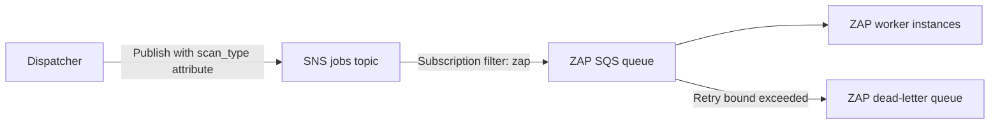

# Publish–Subscribe

**Status:** Local SNS/SQS infrastructure is implemented and routing has been
verified. Application publication and worker consumption remain pending feature
work. Production AWS behavior and IAM acceptance are not established by local
emulator tests.

## Problem and application

The publisher needs to announce a scan job without knowing which worker instance
will execute it. ElasticScan publishes to an SNS topic, and subscriptions route
messages into queues owned by scanner-specific workers.

SNS provides the publish–subscribe boundary. SQS buffers messages so worker
availability and execution speed are independent of publication. Multiple worker
instances consuming one queue compete for its messages; separate SNS subscriptions
can route copies to separate consumer queues.

## Current configuration

The bootstrap provisions `elasticscan-jobs`, a raw-delivery subscription filtered
on message attribute `scan_type=zap`, `elasticscan-zap`, and a dead-letter queue.
The ZAP queue's source policy restricts SNS publication to the configured topic.

See [provisioning](../../docker/localstack/provision.py),
[Compose](../../compose.yaml), and the
[bootstrap verification script](../../scripts/verify_local.py). The smoke check
publishes controlled ZAP and unrelated scan-type messages, then checks that only
the matching messages reach the configured queue.

## Tradeoffs and related patterns

Topic publication acceptance does not prove queue delivery or scan completion.
Delivery can be duplicated, and the design must not depend on global message
ordering. Operators need queue, subscription-delivery, and stalled-job monitoring.
Each added scan type needs a compatible message schema, routing attribute,
subscription filter, dedicated queue, and worker adapter.

[Transactional Outbox](transactional-outbox.md) makes the database-to-publication
handoff recoverable. [Idempotent Consumer](idempotent-consumer.md) handles repeated
deliveries at the worker. Neither is implemented merely by provisioning SNS/SQS.

This pattern supports FR-015–FR-017 and AC-003 in the
[requirements](../requirements.md). See [local development](../local-development.md)
for endpoint configuration and local verification boundaries.

## Dedicated routing verification (US-006.2)

`docker/localstack/provision.py` receives SNS/SQS clients and optional resource
names. Default names preserve bootstrap behavior; test-specific names isolate
verification. It creates the topic, ZAP queue and DLQ, applies the topic-restricted
queue policy, and sets subscription filter scope, filter policy, and raw delivery.
Reruns explicitly restore subscription attributes. The returned identifiers let
tests inspect resources without guessing their URLs or subscription ARN.

`tests/integration/test_queue_routing.py` verifies configuration, repeatable
provisioning with restoration of changed subscription settings and no duplicate
subscription, and delivery using a controlled publisher. Attribute/body mismatch
fixtures establish that routing uses `scan_type` metadata, while exact body
comparison establishes raw delivery. Unrelated/missing attributes are observed
for 15 seconds; matching duplicates are permitted. Temporary resources are
removed; no application queue is consumed. `scripts/verify_local.py` additionally
checks explicit attribute scope in its existing bootstrap smoke verification.

This reuses Publish–Subscribe; receiving clients from callers is existing
dependency injection. Idempotent provisioning is ordinary infrastructure
configuration, distinct from Idempotent Consumer execution guarantees. Benefits
are repeatable local routing and independent queues; limitations include eventual
delivery, duplicates, and maintaining consistent attributes and payloads.

Coverage is local FR-016/AC-003 routing, using controlled FR-015 attributes. The
application publisher, worker, recoverable dispatch loop, and full FR-014/AC-007
outage recovery remain pending. LocalStack configuration checks are not AWS IAM
acceptance. A later Terraform deployment should preserve equivalent routing and
permissions, with real AWS verification. See the
[local development guide](../local-development.md#us-0062-dedicated-queue-routing).
