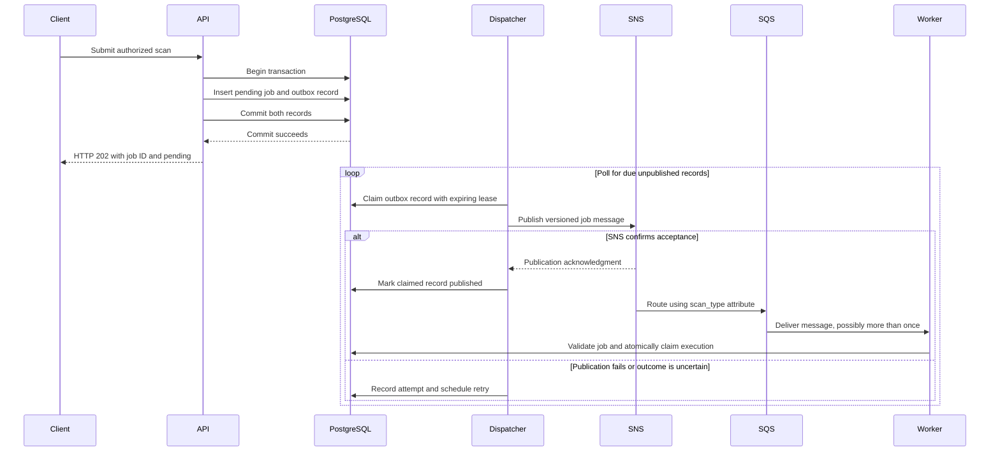

# Transactional outbox and background dispatcher

**Status:** Proposed reliability design from the [requirements](../requirements.md),
Sections 5 and 6.4. The local stack currently runs an idle dispatcher placeholder;
US-004.1 implements the job and dispatch-intent schema (see the
[storage guide](../database-migrations.md)). The acceptance transaction, publisher,
retry loop, and worker recovery logic are not yet implemented. This document describes their intended behavior.

### Problem: saving a job and publishing its message

The original flow is:

```text
API → save job in PostgreSQL → publish to SNS → SQS → worker
```

Saving the job and publishing to SNS are separate operations. A database
transaction cannot atomically commit an SNS publication with its database writes.
If the database commit succeeds and publication fails—or the API crashes before
publishing—the job exists but no worker receives its message. Publishing first
creates the opposite risk: a worker receives a message for a job whose database
transaction later fails.

The **Transactional Outbox pattern** makes the intent to publish durable alongside
the job. A separate process, called the **dispatcher** or **message relay**, then
delivers that intent to SNS and retries failures.

### Intended ElasticScan flow



The job and its outbox record must be inserted in **one PostgreSQL transaction**.
Either both are committed or neither is committed. HTTP 202 follows durable
acceptance; it does not wait for SNS or scanner execution. A persistence failure
must not produce a successful acceptance response.

The dispatcher publishes messages only. The worker owns scanner execution and
persists scan outcomes. PostgreSQL remains the source of truth for job state.

### Outbox records and background processing

The following fields describe the logical record. The current schema stores
publication metadata in `dispatch_intents` and reads payload/routing fields from
the immutable referenced job:

| Field | Purpose |
| --- | --- |
| `id`, `job_id` | Stable event identity and reference to the accepted job |
| `schema_version`, payload and routing attributes | Versioned message built from immutable, validated job parameters; includes `scan_type=zap` for routing |
| `created_at`, `published_at` | UTC creation time and nullable publication completion time |
| `attempt_count`, `next_attempt_at` | Retry history and when the record becomes eligible again |
| Claim token and lease expiry | Prevent competing dispatchers from owning the same current publication attempt |
| Safe error code | Diagnose failed publication without storing credentials or sensitive response bodies |

A dispatcher runs continuously as a separate service:

1. Find a bounded batch of unpublished records whose retry time is due and whose
   claim is absent or expired.
2. Atomically claim records in a short database transaction. Multiple dispatcher
   instances must coordinate through PostgreSQL rather than process-local locks.
3. Commit the claim transaction before calling SNS. Do not hold database row locks
   across a network request.
4. Publish the message using the configured SNS endpoint, topic, and routing
   attributes.
5. On confirmed success, record `published_at` using a conditional update that
   checks the current claim token.
6. On failure, record the attempt, schedule a retry, and release the claim using
   the same ownership check. An expired dispatcher must not overwrite a newer
   dispatcher's claim or publication result.
7. Wait briefly when no work is due. On shutdown, stop claiming new work; unfinished
   claims remain recoverable after their leases expire.

Retry delays should use capped exponential backoff with jitter to avoid many
records retrying simultaneously during an outage. Delays such as 5 seconds,
15 seconds, and 1 minute are illustrative only. Poll intervals, batch sizes,
timeouts, lease durations, retry limits, and escalation thresholds remain
implementation defaults requiring review.

An SNS outage leaves durable dispatch intent available for later recovery. A
record that repeatedly fails must remain visible for operator action; reaching
a retry limit must not silently delete or abandon the accepted job.

### Publication state and scan state are separate

A scan job can remain `pending` while its outbox record is unpublished or awaiting
a retry. A failed publication attempt does not mean the scanner failed. Likewise,
`published_at` means SNS acknowledged a message; it does not mean SQS delivered it
or a worker completed the scan.

Once SNS accepts a message, subscription delivery and SQS consumption have their
own failure and recovery paths. The dispatcher does not replace queue monitoring,
dead-letter handling, or reconciliation of stalled jobs.

### Duplicate delivery and idempotent consumers

This design permits **at-least-once message delivery**. SNS might accept a message
just before the dispatcher crashes, or its acknowledgment might be lost. The
outbox record then remains unpublished and a later attempt can publish it again.
An expiring lease can also permit overlapping publication attempts during a slow
network call. Claim tokens protect database updates; they cannot retract an SNS
message that has already been accepted.

Workers therefore need the related [Idempotent Consumer pattern](idempotent-consumer.md):

- Validate the message against the stored job, then atomically claim execution
  using the job ID and persisted lifecycle/lease rules.
- Prevent a competing delivery from acquiring another valid concurrent claim.
- Preserve an existing terminal outcome when an old message is delivered again.
- Delete the SQS message only after storing the outcome durably or confirming
  an already stored terminal outcome.

This does not promise exactly-once physical scanner execution across worker
crashes. Worker lease recovery and scanner cleanup need their own implementation
and tests, as required by FR-020 and FR-021.

### Failure and recovery expectations

| Failure | Required recovery behavior |
| --- | --- |
| Job/outbox transaction fails | Roll back both records; do not return HTTP 202 |
| API crashes after commit | Dispatcher can discover and publish the committed outbox record |
| SNS unavailable | Retain intent, record the failure, and retry after backoff |
| Dispatcher crashes while holding a claim | Another dispatcher can reclaim the record after lease expiry |
| SNS accepts but publication completion is not recorded | Retry may duplicate the message; worker claim and terminal-state protection handle redelivery |
| SNS accepts but downstream delivery or execution stalls | Queue monitoring, dead-letter handling, and job reconciliation must detect and recover the problem |
| Worker cannot persist its outcome | Leave the message unacknowledged for recovery |

### Where immediate API publication fits

The API can optionally attempt publication immediately **after** committing the
job and outbox record. That is an optimization, not the reliability mechanism.
It must coordinate through the same outbox claim and completion rules as the
dispatcher. If publication fails or its outcome is uncertain, durable intent
remains for background recovery. The HTTP acceptance path must stay bounded and
must not report rejection merely because SNS is unavailable after durable commit.

The current proposed flow uses the separate dispatcher for publication, keeping
SNS latency and retries outside API request processing. No immediate publication
path is implemented in the bootstrap.

### Traceability and verification

This design supports FR-014 (recoverable dispatch intent), FR-020/FR-021
(duplicate delivery and durable acknowledgment), and NFR-013 (outage recovery).
Its principal acceptance checks are AC-001, AC-006, AC-007, and AC-008 in the
[RAD](../requirements.md#10-acceptance-criteria-and-traceability).

Implementation tests must exercise transaction rollback, an API crash after
commit, SNS failure followed by recovery, competing dispatchers, expired claims,
an acknowledgment lost after successful publication, and duplicate worker
deliveries. Publication failures, oldest unpublished-record age, retry counts,
and expired claims must be observable without logging bearer tokens, credentials,
or sensitive scan parameters.

See [Local development](../local-development.md) for the running bootstrap services
and the distinction between verified configuration and pending feature work.
