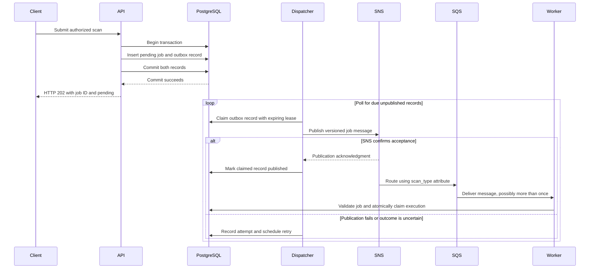

# Transactional outbox and background dispatcher

**Status:** Partially implemented reliability design from the
[requirements](../requirements.md), Sections 5 and 6.4. US-004.1 implements the
job/dispatch-intent schema, US-002.2 maps verified ownership during insertion,
and US-004.2 implements atomic database acceptance with PostgreSQL rollback and
visibility tests. See the [storage guide](../database-migrations.md).
US-003.2 implements production HTTP submission. US-006.1 implements versioned
publication and a separate dispatcher. US-006.3 adds bounded publication retry,
jittered backoff and expired-claim recovery. Worker recovery remains pending;
the complete flow below includes its intended integration. See the [publication guide](../job-publication.md).

### Implemented database acceptance

`app/services/acceptance.py` provides `accept_scan(sessions, *, submission,
context)`. It receives a validated submission and a verified `TeamContext`, then
opens one session/transaction. The existing `create_pending_job` repository
inserts the pending job with immutable ownership; the service adds its matching
`DispatchIntent` and flushes. Successful transaction exit commits both and closes
the session. Only then does the function return an immutable `AcceptedScan`
snapshot containing the UUID, scan type, and acceptance status `pending`.

The service makes no SNS, SQS, or scanner calls. It propagates failures instead
of returning acceptance. Confirmed transaction failures roll back both records;
a connection loss during commit can leave the caller uncertain about the outcome,
although the database still commits both or neither. There is no automatic retry
or request deduplication for uncertain commits.

The schema's foreign key prevents orphan intent, but does not require every
arbitrary job insert to include intent. Application acceptance must use the
service. This is the transaction boundary around the existing
[Repository](repository.md), returning a [Value Object](value-object.md).

Five tests in `tests/integration/test_job_storage.py` exercise successful commit
and fresh-pool reload, a failure after job insertion, an actual dispatch insert
constraint violation, failure after both inserts before commit, and separate
connection visibility only after commit. They use the real migration and
PostgreSQL, with failure injection confined to the tests. Production HTTP 202/503
behavior is implemented in US-003.2. US-006.3 verifies dispatcher process restart
and SNS access restoration using the same durable job. API process-crash and
worker recovery demonstrations remain separate verification.

### Problem: saving a job and publishing its message

The original flow is:

```text
API → save job in PostgreSQL → publish to SNS → SQS → worker
```

Saving the job and publishing to SNS are separate operations. A database
transaction cannot atomically commit an SNS publication with its database writes.
If the database commit succeeds and publication fails—or the API crashes before
publishing—the job exists but no worker receives its message. Publishing first
creates the opposite risk: a worker receives a message for a job whose database
transaction later fails.

The **Transactional Outbox pattern** makes the intent to publish durable alongside
the job. A separate process, called the **dispatcher** or **message relay**, then
delivers that intent to SNS and retries failures.

### Intended ElasticScan flow



The job and its outbox record must be inserted in **one PostgreSQL transaction**.
Either both are committed or neither is committed. HTTP 202 follows durable
acceptance; it does not wait for SNS or scanner execution. A persistence failure
must not produce a successful acceptance response.

The dispatcher publishes messages only. The worker owns scanner execution and
persists scan outcomes. PostgreSQL remains the source of truth for job state.

### Outbox records and background processing

The following fields describe the logical record. The current schema stores
publication metadata in `dispatch_intents` and reads payload/routing fields from
the immutable referenced job:

| Field | Purpose |
| --- | --- |
| `id`, `job_id` | Stable event identity and reference to the accepted job |
| `schema_version`, payload and routing attributes | Versioned message built from immutable, validated job parameters; includes `scan_type=zap` for routing |
| `created_at`, `published_at` | UTC creation time and nullable publication completion time |
| `attempt_count`, `next_attempt_at` | Retry history and when the record becomes eligible again |
| Claim token and lease expiry | Prevent competing dispatchers from owning the same current publication attempt |
| Safe error code | Diagnose failed publication without storing credentials or sensitive response bodies |

The publication portion below is implemented by US-006.1/US-006.3, including
short claim transactions, token-guarded finalization, shutdown, bounded retries
and expired-attempt reclamation within the remaining budget:

1. Find a bounded batch of unpublished records whose retry time is due and whose
   claim is absent or expired.
2. Atomically claim records in a short database transaction. Multiple dispatcher
   instances must coordinate through PostgreSQL rather than process-local locks.
3. Commit the claim transaction before calling SNS. Do not hold database row locks
   across a network request.
4. Publish the message using the configured SNS endpoint, topic, and routing
   attributes.
5. On confirmed success, record `published_at` using a conditional update that
   checks the current claim token.
6. On failure, record the attempt, schedule a retry, and release the claim using
   the same ownership check. An expired dispatcher must not overwrite a newer
   dispatcher's claim or publication result.
7. Wait briefly when no work is due. On shutdown, stop claiming new work; unfinished
   claims remain recoverable after their leases expire.

Retry delays use capped exponential backoff with jitter to spread retries.
The accepted implementation defaults are five total attempts, retry ranges of
1–2, 2–4, 4–8 and 8–16 seconds, a 60-second lease, two-second polling and ten-record
batches. The delay function caps at 30 seconds. These code defaults are not a
production availability commitment. Network/polling latency adds to the delays.

An SNS outage leaves durable dispatch intent available for later recovery. A
record that repeatedly fails must remain visible for operator action; reaching
a retry limit must not silently delete or abandon the accepted job.

### Publication state and scan state are separate

A scan job can remain `pending` while its outbox record is unpublished or awaiting
a retry. A failed publication attempt does not mean the scanner failed. Likewise,
`published_at` means SNS acknowledged a message; it does not mean SQS delivered it
or a worker completed the scan.

Once SNS accepts a message, subscription delivery and SQS consumption have their
own failure and recovery paths. The dispatcher does not replace queue monitoring,
dead-letter handling, or reconciliation of stalled jobs.

### Duplicate delivery and idempotent consumers

This design permits **at-least-once message delivery**. SNS might accept a message
just before the dispatcher crashes, or its acknowledgment might be lost. The
outbox record then remains unpublished and a later attempt can publish it again.
An expiring lease can also permit overlapping publication attempts during a slow
network call. Claim tokens protect database updates; they cannot retract an SNS
message that has already been accepted.

Workers therefore need the related [Idempotent Consumer pattern](idempotent-consumer.md):

- Validate the message against the stored job, then atomically claim execution
  using the job ID and persisted lifecycle/lease rules.
- Prevent a competing delivery from acquiring another valid concurrent claim.
- Preserve an existing terminal outcome when an old message is delivered again.
- Delete the SQS message only after storing the outcome durably or confirming
  an already stored terminal outcome.

This does not promise exactly-once physical scanner execution across worker
crashes. Worker lease recovery and scanner cleanup need their own implementation
and tests, as required by FR-020 and FR-021.

### Failure and recovery expectations

| Failure | Required recovery behavior |
| --- | --- |
| Job/outbox transaction fails | Roll back both records; do not return HTTP 202 |
| API crashes after commit | Dispatcher can discover and publish the committed outbox record |
| SNS unavailable | Retain intent, record the failure, and retry after backoff |
| Dispatcher crashes while holding a claim | Another dispatcher can reclaim the record after lease expiry |
| SNS accepts but publication completion is not recorded | Retry may duplicate the message; worker claim and terminal-state protection handle redelivery |
| SNS accepts but downstream delivery or execution stalls | Queue monitoring, dead-letter handling, and job reconciliation must detect and recover the problem |
| Worker cannot persist its outcome | Leave the message unacknowledged for recovery |

### Where immediate API publication fits

The API can optionally attempt publication immediately **after** committing the
job and outbox record. That is an optimization, not the reliability mechanism.
It must coordinate through the same outbox claim and completion rules as the
dispatcher. If publication fails or its outcome is uncertain, durable intent
remains for background recovery. The HTTP acceptance path must stay bounded and
must not report rejection merely because SNS is unavailable after durable commit.

The current proposed flow uses the separate dispatcher for publication, keeping
SNS latency and retries outside API request processing. No immediate publication
path is implemented in the bootstrap.

### Traceability and verification

This design supports FR-014 (recoverable dispatch intent), FR-020/FR-021
(duplicate delivery and durable acknowledgment), and NFR-013 (outage recovery).
Its principal acceptance checks are AC-001, AC-006, AC-007, and AC-008 in the
[RAD](../requirements.md#10-acceptance-criteria-and-traceability).

Transaction rollback and paired commit visibility are covered in US-004.2.
US-006.3 tests SNS access failure/restoration across isolated dispatcher processes,
retry timing/budget, expired claims, invalid messages, and finalization failure
after mocked SNS success. Existing publication tests cover competing calls and
stale token rejection. API crash after commit, duplicate worker delivery and
complete worker recovery remain separate checks. Safe logs and a read-only
inspection query expose attempt counts, due/expired leases and invalid/exhausted
states. Comprehensive metrics and external alerting remain future operational
work; parameters, credentials and bearer tokens are not logged.

See [Local development](../local-development.md) for the running bootstrap services
and the distinction between verified configuration and pending feature work.


### Implemented relay and bounded recovery (US-006.1 and US-006.3)

`app/dispatchers/publication.py` receives the session factory and SNS client.
`dispatch_conditions()` is shared by discovery and atomic claiming. It excludes
published/suppressed intent, nonpending/cancel-requested jobs, active claims,
future due times, invalid payloads and consumed five-attempt budgets. The first
transaction validates `JobMessage`, increments the attempt count and commits a
random token, lease and crash-recovery time before network publication.
The second transaction finalizes only the current token; a handled failure
releases it and schedules jittered backoff. A crash leaves the original claim
recoverable after lease expiry plus saved delay, within the remaining budget.
`app/dispatchers/main.py` discovers at most ten due intents and waits two seconds.

The API's durable acceptance stays independent of SNS latency. Benefits are
preserved intent, bounded network pressure, database-coordinated ownership and
restart recovery. Tradeoffs are two database commits per network attempt,
possible duplicates after uncertain acknowledgment/finalization, finite recovery
coverage and operator responsibility after exhaustion. No job/intent is deleted
or scan marked failed when publication exhausts. A final crashed claim consumes
its attempt too: the counter and expired lease expose exhaustion even if no
process survives to write a final error/log. Restart does not reset the budget.
The inspection query and recovery boundaries are in the
[publication guide](../job-publication.md).

`tests/integration/test_publication.py` covers committed claims, competing calls,
stale owners, saved failure/recovery, due-time and budget guards, expired claims,
invalid exclusion and identical republication after finalization failure. Its
LocalStack test starts a real dispatcher with an unreachable local SNS endpoint,
stops it after the saved failure, then restarts against real LocalStack and
verifies the same job's versioned message in an isolated ZAP queue. This does
not interrupt the shared emulator or establish real AWS IAM behavior.
`tests/unit/test_dispatcher.py` checks retry bounds, shutdown and safe database
failure waits. Worker execution, reconciliation and queue-consumer idempotency
remain future work. Backoff, leases and conditional writes support the outbox
pattern; they are not separate patterns introduced by this story.
