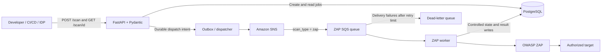

# ElasticScan — Requirements Analysis Document

| Document attribute | Value |
| --- | --- |
| Version | 0.4 — Local Keycloak deployment confirmed |
| Date | 2026-11-03 |
| Project | ElasticScan: Security Scanning as a Service |
| Intended audience | Developers, clients, security reviewers, operators, and project stakeholders |
| Source documents | `../../0-description.md`, `../../1-generate-RAD.md` |
| Approval status | Clarification choices confirmed; technical defaults pending review |

## 1. Introduction

ElasticScan is a Python application that exposes security scanning tools through a unified REST API. Developers, CI/CD pipelines, and Internal Developer Platforms such as Backstage can submit scans and retrieve their status and results without integrating directly with each scanning tool.

The application uses FastAPI and Pydantic for the API, SQLAlchemy and PostgreSQL for persistence, and Amazon SNS and SQS for asynchronous job distribution. Dedicated workers execute scans independently of API request processing. The minimum viable product (MVP) supports OWASP ZAP for Dynamic Application Security Testing (DAST).

## 2. Purpose and document conventions

This document defines the functional requirements, quality requirements, project boundaries, stakeholder responsibilities, assumptions, constraints, and acceptance criteria for the MVP. It provides a baseline for implementation planning, test design, and stakeholder acceptance.

“Shall” identifies a required behavior. “Should” identifies a recommendation. Requirements marked **proposed** depend on stakeholder clarification and are not approved commitments. Performance figures are proposed acceptance targets, not measurements or claims about an existing implementation.

Requirement identifiers provide traceability: FR denotes functional requirements, NFR denotes non-functional requirements, and AC denotes acceptance criteria.

## 3. Scope and deliverables

### 3.1 Confirmed MVP scope

- Submit an OWASP ZAP scan through `POST /scan`.
- Validate requests and persist a uniquely identified job with status `pending`.
- Dispatch jobs asynchronously through SNS to a dedicated ZAP SQS queue.
- Execute scans in dedicated workers and persist status and outcomes.
- Retrieve job status and results through `GET /scan/{job_id}`.
- Support `pending`, `running`, `completed`, and `failed`, with a proposed `cancelled` terminal state for the selected cancellation feature.
- Run unauthenticated ZAP baseline scans against explicitly authorized, allowlisted public HTTP/HTTPS targets.
- Provide team-scoped job listing, cancellation, and deletion.
- Deliver AWS deployment and local development configuration.
- Preserve an extension point for additional scan types and worker queues.

### 3.2 Proposed implementation deliverables

- API application, request/response schemas, and generated OpenAPI documentation.
- PostgreSQL schema and versioned migrations.
- Durable dispatch mechanism, SNS/SQS configuration, and ZAP worker implementation.
- Automated API, worker, and end-to-end acceptance tests.
- Deployment configuration, environment configuration reference, and operating runbook.
- Documentation of authentication, authorized target policy, failure recovery, and results retention.

AWS deployment and local development are confirmed. Docker Compose is the confirmed local development setup and shall include Keycloak as the local OIDC identity provider, alongside the API, PostgreSQL, dispatcher, and ZAP worker, with configurable SNS/SQS endpoints. The local-development guide shall state whether it uses real AWS resources or an emulator and how to obtain JWT access tokens from the local Keycloak instance. The Compose setup shall provide reproducible realm/client configuration and test users for at least two teams, with a documented trusted team-membership mapping. API audience, issuer, and signing-key discovery shall be configured consistently for host clients and containerized services. Credentials shall use development-only configuration without committed secrets. Local execution shall retain JWT validation and team isolation. Local target-policy tests may use an explicitly isolated fixture network; this shall not enable arbitrary private-network scanning.

### 3.3 Exclusions from the baseline

The baseline does not include a web dashboard, Backstage plugin, scheduled scans, notifications, billing, authenticated website crawling, or integrations with Trivy, Checkov, Gitleaks, Chef InSpec, and OWASP Dependency-Check. These scanners are future candidates, not MVP commitments. Team isolation, job listing, client cancellation, and client deletion are required in the MVP. Active ZAP scanning and authenticated target crawling are excluded. Remediation of discovered vulnerabilities is outside the scanning service's responsibility.

## 4. Stakeholder analysis

| Stakeholder | Role and interest | Responsibility or acceptance input |
| --- | --- | --- |
| Project owner / client | Defines business value and scope | Approves requirements, priorities, deployment scope, and final acceptance |
| Developers and CI/CD consumers | Submit scans and consume results | Validate API usability, integration behavior, and error contracts |
| IDP / Backstage maintainers | Integrate the service into developer workflows | Validate the REST interface and service authentication requirements |
| Application developers | Implement API, persistence, and dispatch | Maintain schemas, lifecycle rules, migrations, and automated tests |
| Security engineers / target owners | Authorize targets and interpret findings | Approve scan policy, test targets, findings handling, and scan mode |
| Platform / AWS operators | Deploy and operate the service | Configure networking, IAM, queues, monitoring, backups, and recovery |
| Worker maintainers | Operate scanner adapters and execution | Maintain ZAP integration, runtime limits, and failure reporting |
| Data / security owner | Governs access and retention | Approves visibility, retention, secrets handling, and deletion policy |

Individuals filling these roles shall be identified before production acceptance. One person may hold multiple roles.

## 5. System context and workflow



The outbox/dispatcher is a proposed reliability refinement of the source workflow: an accepted job must remain recoverably dispatchable if SNS is unavailable after database persistence. The diagram shows controlled direct database writes by workers; a restricted internal API is an acceptable alternative if it enforces the same lifecycle and authorization rules.

1. The API validates an OIDC-issued JWT access token, resolves the caller’s authorized team context, and validates the request and target policy.
2. It generates a job identifier and atomically persists the `pending` job and recoverable dispatch intent.
3. It returns HTTP 202 once that durable acceptance succeeds, without waiting for scan execution.
4. The dispatch mechanism publishes the job message to SNS; filtering routes it to the ZAP queue.
5. A worker validates the message and claims the job before entering `running`.
6. The worker executes ZAP within configured time and resource limits.
7. It atomically persists a terminal status and either a result or a safe failure description.
8. It deletes the SQS message only after the outcome is durably stored, or after verifying an already stored terminal outcome.
9. The client polls the status endpoint until a terminal outcome is available.

## 6. Functional requirements

### 6.1 API submission and retrieval

| ID | Requirement |
| --- | --- |
| FR-001 | The API shall expose `POST /scan` and accept JSON containing `scan_type` and a scan-type-specific `parameters` object. |
| FR-002 | The MVP shall accept only `scan_type: "zap"`; its parameters shall require a non-empty HTTP or HTTPS URL. Unsupported scan types, malformed URLs, missing required fields, and unrecognized fields shall produce HTTP 422 with structured validation details. |
| FR-003 | The API shall generate a UUID job identifier and persist the scan type, validated parameters, status, and timestamps before returning successful acceptance. |
| FR-004 | Successful submission shall return HTTP 202 with `job_id`, `scan_type`, and `status: "pending"`. The response shall represent durable acceptance even if worker processing begins immediately afterward. |
| FR-005 | The API shall expose `GET /scan/{job_id}` and return the job identifier, scan type, current status, timestamps, and the applicable result or safe error information. |
| FR-006 | A malformed job identifier shall return HTTP 422. A valid identifier with no accessible job shall return HTTP 404. Reads shall be scoped to the caller’s authorized owning team. Requests for another team’s job shall return the same HTTP 404 response as an unknown job without revealing its existence. |
| FR-007 | The API shall expose OpenAPI documentation describing schemas, authentication, validation errors, lifecycle states, and examples. |
| FR-008 | If a job cannot be durably accepted because persistence is unavailable, submission shall return HTTP 503 and shall not claim acceptance. Unhandled failures shall use HTTP 500 without exposing stack traces or secrets. |

#### Submission example

```http
POST /scan
Content-Type: application/json
```

```json
{
  "scan_type": "zap",
  "parameters": {
    "url": "https://example.com"
  }
}
```

```json
{
  "job_id": "550e8400-e29b-41d4-a716-446655440000",
  "scan_type": "zap",
  "status": "pending"
}
```

`example.com` is illustrative; demonstrations and acceptance tests shall use an explicitly authorized test target.

#### Completed retrieval example

```json
{
  "job_id": "550e8400-e29b-41d4-a716-446655440000",
  "scan_type": "zap",
  "status": "completed",
  "created_at": "2026-11-03T12:00:00Z",
  "updated_at": "2026-11-03T12:02:00Z",
  "started_at": "2026-11-03T12:00:05Z",
  "finished_at": "2026-11-03T12:02:00Z",
  "result": {
    "high": 1,
    "medium": 3,
    "low": 5
  },
  "error": null
}
```

Additional severity categories may be included when defined in the published result schema. Each count shall be a non-negative integer. A completed scan means successful scanner execution; it does not imply that the target has no vulnerabilities.

For `pending` and `running`, `result` and `error` shall be null. For the proposed `cancelled` state, both shall be null and cancellation metadata shall identify the requesting subject and request/completion times. For `failed`, `result` shall be null and `error` shall contain a stable error code and safe explanatory message. `started_at` may be null if execution never started; `finished_at` shall be set for every terminal state.

**FR-027 — Team ownership and authorization:** Every job shall belong to exactly one team. The service shall derive ownership from a verified identity and trusted team membership mapping. If a caller belongs to multiple teams, an explicit team context shall be checked against that membership before submission, retrieval, listing, cancellation, or deletion. Callers shall not create jobs for, read results from, or transfer ownership to unauthorized teams. Team members may read their team’s jobs, including those submitted by other members. API keys alone shall not satisfy authentication.

**FR-028 — Isolation throughout processing:** Database access for caller-facing job reads shall include the authorized team constraint. Workers and maintenance processes shall use restricted service identities, preserve immutable ownership, and validate job associations before writing results. Client-accessible reports or artifacts, if introduced, shall enforce the same team authorization. There is no cross-team administrative read API in the MVP.

### 6.2 Job lifecycle and CRUD coverage

| Operation | MVP behavior | Responsible actor |
| --- | --- | --- |
| Create | Create jobs through `POST /scan` | Authenticated caller with an authorized team context |
| Read | Retrieve a job through `GET /scan/{job_id}` and list team jobs through `GET /scan` | Authenticated caller in the job’s owning team |
| Update | Request cancellation through `POST /scan/{job_id}/cancel`; service components control execution state, timestamps, and outcomes | Authenticated owning-team caller; API and worker enforce transitions |
| Delete | Delete terminal jobs through `DELETE /scan/{job_id}`; automated expiry follows the configured retention policy | Authenticated owning-team caller or restricted maintenance process |

A generic public update endpoint is excluded because execution state belongs to the service. The endpoint details below are proposed technical contracts for the confirmed job-management scope. The proposed `cancelled` state extends the four-state source description to distinguish user cancellation from scan failure.

| ID | Requirement |
| --- | --- |
| FR-009 | The API shall create jobs in `pending`. Workers shall transition claimed jobs to `running` and then to `completed` or `failed`, with cancellation transitions governed by FR-030–031. |
| FR-010 | Exhausted dispatch or recovery attempts may transition `pending` to `failed` through a restricted service process, recording the reason. |
| FR-011 | State writes shall use atomic claim/transition controls. Terminal jobs shall not be reopened by duplicate messages. |
| FR-012 | Job recovery shall detect abandoned execution through a lease, heartbeat, or equivalent mechanism and recover or fail it within a configured bound. A recovery policy shall cap attempts and document that interrupted scans may execute again. |
| FR-013 | All state transitions shall update UTC timestamps and preserve diagnostic correlation by job identifier. Result persistence and the terminal state update shall be atomic. |

### 6.3 Job listing, cancellation, and deletion — proposed API contracts

| ID | Requirement |
| --- | --- |
| FR-029 | `GET /scan` shall return only the authorized team's jobs, with optional validated `status` and `scan_type` filters. Proposed pagination: `limit` defaults to 20, maximum 100, with an opaque continuation cursor and stable descending creation-time/job-ID order. The response shall contain `items` and nullable `next_cursor`. Cursors shall not bypass team authorization. |
| FR-030 | `POST /scan/{job_id}/cancel` shall cancel a `pending` job atomically before a worker claims it, returning HTTP 200 with `status: cancelled`. For a `running` job it shall durably record a cancellation request and return HTTP 202 with the current status and `cancellation_requested_at`. The worker shall stop scanner resources and persist `cancelled` within a proposed 30-second healthy-worker bound; interrupted workers shall follow bounded recovery. No further target requests shall be initiated after cancellation completes. |
| FR-031 | Cancellation shall be idempotent for an already cancelled job and for an existing in-progress request. Attempts to cancel `completed` or `failed` jobs shall return HTTP 409. Atomic transitions shall resolve completion/cancellation races: a stored terminal outcome shall never be overwritten. If completion wins before cancellation is finalized, the job remains completed; HTTP 202 acknowledges a request rather than guaranteeing cancellation. Workers shall check cancellation before launching ZAP and during execution; recovery shall honor it before restarting work. |
| FR-032 | `DELETE /scan/{job_id}` shall delete a terminal job and its results from API visibility and return HTTP 204. Deleting a nonterminal job shall return HTTP 409; clients shall cancel first. A deletion tombstone shall prevent delayed messages from recreating or executing the job and be retained beyond the configured queue retention, retry, and redrive window. Physical cleanup shall follow a documented bounded process; backup expiry is governed separately. Repeated deletion of a no-longer-visible job shall return HTTP 404. |
| FR-033 | Listing, cancellation, and deletion shall enforce verified team context. Unknown and cross-team job identifiers shall return identical HTTP 404 responses; malformed identifiers shall return HTTP 422. Any owning-team member may perform these operations in the MVP. Durable cancellation/deletion storage failures shall return HTTP 503 without acknowledging success. |

Lifecycle additions: `pending → cancelled`, and `running → cancelled` after confirmed scanner termination. A cancellation request is metadata, not an additional execution state. A pending-job cancellation shall suppress unpublished dispatch intent; previously published messages shall be acknowledged without scanning after the terminal outcome is verified.

### 6.4 Dispatch, messaging, and worker execution

| ID | Requirement |
| --- | --- |
| FR-014 | Every accepted job shall have durable, recoverable dispatch intent. A transactional outbox or equivalent mechanism shall prevent jobs from becoming silently stranded between database creation and SNS publication. |
| FR-015 | Messages shall contain a schema version, job identifier, scan type, and required validated scan parameters. SNS publication shall include a `scan_type` routing attribute. |
| FR-016 | The ZAP queue subscription shall filter on `scan_type = zap`. Other scan types shall not be delivered to the ZAP worker through this subscription. |
| FR-017 | Workers shall poll their dedicated queue, validate message schema, and verify the job and stored parameters before executing a scan. Malformed or inconsistent messages shall not trigger scanning. |
| FR-018 | The worker shall execute ZAP baseline mode: time-bounded crawling followed by passive analysis, without active attack scanning or target login credentials. It shall enforce target boundaries, collect severity counts, and record execution success or classified failure. A crawl limit shall be configured separately from the overall job timeout; crawl completion alone does not mean the job has finished. Vulnerability findings shall not themselves make a successfully executed scan `failed`; scanner process exit codes shall be interpreted accordingly. |
| FR-019 | Visibility timeout handling shall cover the execution lease; workers shall extend visibility where required. Delivery attempts, retry delays, scan duration, and worker concurrency shall be configurable. |
| FR-020 | Duplicate deliveries and competing workers shall not create multiple valid concurrent claims or overwrite an existing terminal outcome. The service shall not promise exactly-once physical scanner execution across worker crashes. |
| FR-021 | The worker shall delete a message only after durably storing its outcome or confirming a terminal outcome already exists. Storage failure shall leave the message available for recovery. |
| FR-022 | Transient infrastructure failures shall use bounded retry behavior. Non-retryable scanner failures shall persist `failed` with a safe reason. Exhausted delivery attempts shall route messages to a dead-letter queue with observable diagnostics. |
| FR-023 | A reconciliation process shall correlate dead-lettered or abandoned jobs with their database records and resolve them through controlled recovery or terminal failure. Redrive procedures shall preserve duplicate-handling controls. |
| FR-024 | Future tools shall be addable through scan-type validation, routing configuration, and worker adapters without breaking the existing submission and status contracts. Adding tools may require additional typed parameter schemas and deployment configuration. |

### 6.5 Data requirements

| Field / entity | Requirement |
| --- | --- |
| `job_id` | UUID primary identifier, unique and immutable |
| `scan_type` | Validated tool identifier; MVP value `zap` |
| `parameters` | Validated JSON parameters; immutable after acceptance |
| `status` | Constrained to the lifecycle states; proposed cancellation extension adds `cancelled` |
| Cancellation metadata | Nullable request/completion times and requesting subject; persisted atomically with cancellation decisions |
| Deletion metadata | Tombstone sufficient to suppress delayed message execution; no retained scan parameters or results |
| Timestamps | UTC creation, update, optional start, and terminal finish timestamps |
| `result` | Structured severity summary on completion; null otherwise |
| `error` | Safe error code and message on failure; null otherwise |
| Execution metadata | Attempt count, claim/lease metadata, and correlation information sufficient for retry and recovery |
| Dispatch intent | Durable publication state and retry metadata, in the same acceptance transaction as the job |
| Caller / owner | Mandatory immutable `team_id` and submitting subject identifier (`created_by`); assigned from validated identity and authorized team context, never from an unchecked request field |

**FR-025:** PostgreSQL shall be the source of truth for job status and structured outcomes. Schema migrations shall be versioned. Raw ZAP reports or external artifact storage are optional pending requirements confirmation; the MVP shall not require them for status retrieval.

**FR-026 (proposed):** A configurable retention process shall remove terminal jobs and associated artifacts after 30 days, protect nonterminal jobs from routine expiry, and expose failures in cleanup. Backup retention and the availability of deleted data in backups shall be documented separately.

## 7. Non-functional requirements

### 7.1 Performance and capacity

| ID | Proposed requirement and measurement |
| --- | --- |
| NFR-001 | Under a documented acceptance environment, `POST /scan` and `GET /scan/{job_id}` shall each meet p95 response latency of at most 1 second over a 10-minute run at 10 requests/second total, excluding client network latency. Acceptance includes durable local persistence/dispatch intent, not scan completion. |
| NFR-002 | At that load, valid API requests shall have less than 1% unexpected server errors when dependencies are healthy. Expected validation/authentication responses shall be reported separately. |
| NFR-003 | The API shall remain responsive while at least two jobs execute concurrently across workers. Queue depth may grow when scan demand exceeds worker capacity. No scan-completion latency guarantee is assumed until target size, scan mode, and resource limits are agreed. |
| NFR-004 | Each scan shall have a configurable timeout, initially proposed as 15 minutes for baseline scanning. Timeout shall terminate scanner resources and produce a persisted failure or bounded recovery path. |

The deployment size, test target, dataset size, and hardware shall be recorded with benchmark results. These targets require stakeholder confirmation.

### 7.2 Security

| ID | Requirement |
| --- | --- |
| NFR-005 | All scan submission, retrieval, listing, cancellation, and deletion endpoints shall require OIDC-issued JWT bearer access tokens. Validation shall enforce the configured issuer, API audience, expiration, applicable not-before time, signature, and explicit allowed signing algorithms using trusted issuer keys with rotation support. Missing, invalid, expired, incorrectly signed, wrong-issuer, or wrong-audience tokens shall return HTTP 401. An authenticated caller lacking an authorized team context or permission to submit shall receive HTTP 403. Cross-team retrieval, cancellation, and deletion shall return HTTP 404 under FR-006 and FR-033. |
| NFR-006 | The service shall scan only explicitly authorized targets under a configured policy. The confirmed baseline permits only allowlisted public HTTP/HTTPS targets, with private, loopback, link-local, and cloud metadata destinations blocked. Private-network scans are outside MVP scope except for isolated test fixtures described in Section 3.2. |
| NFR-007 | Target restrictions shall apply to initial resolution, redirects, and scanner-discovered destinations using application validation plus enforceable scanner/egress controls. Acceptance tests shall cover attempts to escape the authorized target boundary. |
| NFR-008 | ZAP execution shall avoid shell interpolation of user input. Workers shall run with bounded CPU, memory, time, and concurrency, and shall prevent API callers from supplying arbitrary scanner commands. |
| NFR-009 | Deployed API and service connections shall use TLS where supported by the selected deployment. Secrets shall be injected through a restricted configuration or secret-management mechanism and shall not be committed or logged. |
| NFR-010 | IAM, queue policies, and database credentials shall follow least privilege. SQS publication shall be restricted to the intended SNS source; worker write access shall be limited to required job operations. |
| NFR-011 | Logs and public errors shall omit credentials, stack traces, and sensitive response bodies. Target query strings and scan content shall be treated as potentially sensitive. Caller subject, owning team, job ID, authorization failures, and state transitions shall be auditable without logging bearer tokens. |
| NFR-012 | The service shall enforce configurable submission rate and worker concurrency limits and return HTTP 429 when caller rate limits are exceeded. Stored results and backups shall use encryption at rest in the deployed environment. |

### 7.3 Reliability and operability

| ID | Requirement |
| --- | --- |
| NFR-013 | Temporary SNS, SQS, database, or worker outages shall not silently lose durably accepted jobs. Recovery shall be bounded and observable; successful execution of every accepted scan is not guaranteed. |
| NFR-014 | API and worker deployments shall scale independently. Worker shutdown shall stop new claims and either persist the current outcome or leave a recoverable lease and message. |
| NFR-015 | Structured logs and metrics shall cover API errors/latency, pending age, queue depth, oldest message age, dispatch failures, scan duration, outcomes, retries, and dead-letter depth. Job IDs shall correlate API, dispatch, and worker activity. |
| NFR-016 | Operators shall have liveness/readiness checks and a runbook for stalled jobs, dependency outages, queue redrive, backup restoration, and key rotation. Readiness shall reflect the ability to durably accept requests; an SNS outage alone need not block acceptance when durable dispatch recovery is healthy. |
| NFR-017 | Backup frequency, recovery point objective, recovery time objective, and availability objectives shall be agreed before production acceptance. No production SLA is implied by this draft. |

### 7.4 Maintainability and compatibility

| ID | Requirement |
| --- | --- |
| NFR-018 | API, persistence, dispatch, and scanner integration concerns shall have distinct modules. Scanner-specific behavior shall be isolated behind a documented adapter contract. |
| NFR-019 | Dependencies and runtime versions shall be pinned or constrained reproducibly. API examples and environment configuration shall be documented without embedded credentials. |
| NFR-020 | Tests shall cover validation, lifecycle transitions, routing, duplicate delivery, dependency failures, and an end-to-end scan against an authorized test application. |
| NFR-021 | Existing `POST /scan` and `GET /scan/{job_id}` clients shall remain compatible when adding scanners. Breaking schema changes shall require a documented versioning and migration strategy. |

## 8. Assumptions and dependencies

### 8.1 Assumptions

- Target owners authorize the scans and provide suitable test targets.
- Clients poll for status; callbacks and live result streaming are excluded.
- ZAP findings are scanner output and can include false positives or missed vulnerabilities; a completed job is an execution outcome, not security certification.
- Platform operators can operate the selected AWS deployment and provide local development configuration.
- An OIDC provider supplies API access tokens and a trusted mapping to team membership. Keycloak in Docker Compose is confirmed for local development. The production provider, claim names, issuer, audience, and membership provisioning process remain deployment decisions.
- API submission retries may create separate jobs. Client-supplied idempotency keys are outside the baseline; delivery deduplication applies within an existing job.
- Only structured severity summaries are required initially; evidence-rich reports need separate agreement on data sensitivity and storage.

### 8.2 External dependencies

| Dependency | Required capability / owner |
| --- | --- |
| FastAPI and Pydantic | REST API and typed validation; application developers |
| SQLAlchemy and PostgreSQL | Transactional job persistence and migrations; application and platform owners |
| Amazon SNS | Job publication and scan-type routing; AWS operators |
| Amazon SQS and dead-letter queue | Buffered delivery, retries, visibility management, and failed-delivery isolation; AWS operators |
| OWASP ZAP runtime | Reproducible scan execution and machine-readable findings; worker maintainers |
| DNS and controlled network egress | Reach authorized targets while enforcing destination policy; platform/security owners |
| Authorized test application | Safe, reproducible acceptance testing; target owner |
| Credential and configuration delivery | Restricted secrets and environment configuration; platform owner |
| OIDC identity provider | Local development: Keycloak running in Docker Compose, supplying JWT access tokens, issuer metadata/signing keys, and trusted team membership mapping. Production provider remains undecided; identity/platform owner |

No particular AWS region, compute platform, or third-party report storage service is selected by the source description.

## 9. Constraints and risks

| Constraint / risk | Required response |
| --- | --- |
| Python, FastAPI, Pydantic, SQLAlchemy, PostgreSQL, SNS, and SQS are specified components | Keep the MVP architecture aligned with the source description |
| One scanner in the MVP | Deliver ZAP first; do not treat future integrations as acceptance blockers |
| Cross-system persistence and publication are not a single transaction | Preserve durable dispatch intent and test publication outage recovery |
| Message redelivery and worker crashes | Use atomic claims, leases, bounded recovery, and terminal-state protection |
| Scans vary greatly in runtime and can affect targets | Set explicit scan mode, authorization, concurrency, and runtime limits |
| Scanner-controlled network access can exceed the submitted URL | Enforce destination boundaries throughout execution |
| AWS cost and capacity are unapproved | Confirm budget, deployment sizing, retention, and scaling limits before production rollout |
| No schedule, team allocation, or production service objectives are supplied | Treat delivery dates, staffing, SLA, and recovery targets as unresolved |

## 10. Acceptance criteria and traceability

Acceptance shall be demonstrated in a documented environment using authorized targets. Proposed choices and targets must be confirmed before production sign-off.

| ID | Scenario and observable acceptance outcome | Traces to |
| --- | --- | --- |
| AC-001 | A valid authorized ZAP request returns HTTP 202 with a UUID and `pending`; the job and dispatch intent are committed and remain retrievable after API restart. | FR-001–004, FR-014 |
| AC-002 | Missing URL, unsupported scan type, malformed URL, invalid UUID, and unknown job produce the specified HTTP 422/404 responses without creating unintended jobs. | FR-002, FR-006 |
| AC-003 | A published ZAP job reaches the ZAP queue; a message with another scan-type routing attribute does not. | FR-015–017 |
| AC-004 | A worker moves an accepted job through `running` to `completed`, storing valid severity counts and timestamps; polling returns the persisted outcome. | FR-005, FR-009, FR-013, FR-018, FR-025 |
| AC-005 | A reproducible scanner error or timeout produces a terminal `failed` job with a safe error code, and scanner resources are released. | FR-018, FR-022, NFR-004, NFR-008 |
| AC-006 | Concurrent deliveries of one job result in at most one current valid worker claim; redelivery after completion leaves the stored terminal outcome unchanged. | FR-011–012, FR-020 |
| AC-007 | If SNS publication fails after durable acceptance, the job remains discoverable and publishes after recovery without losing the job. If initial database persistence fails, submission returns HTTP 503 and no accepted job is claimed. | FR-008, FR-014, NFR-013 |
| AC-008 | A terminal persistence failure prevents message deletion; worker interruption results in bounded recovery or a recorded failure under the configured policy. | FR-012–013, FR-019–021 |
| AC-009 | A poison message reaches the dead-letter queue after the configured retry bound; operators can identify it, and affected jobs can be reconciled without uncontrolled duplicate execution. | FR-017, FR-022–023, NFR-015–016 |
| AC-010 | Under the approved access model, credential and visibility tests enforce caller access; target-policy tests block unauthorized URLs, redirects, and scanner-discovered out-of-scope destinations. | NFR-005–007, NFR-010 |
| AC-011 | The proposed benchmark demonstrates the approved API latency/error targets while two scans execute, with environment and load results recorded. | NFR-001–003 |
| AC-012 | Documentation and tests demonstrate a clear scanner adapter/routing extension point without changing existing client contracts. Implementing a second scanner is not required. | FR-024, NFR-018, NFR-021 |
| AC-013 | An operator can deploy the agreed environments, apply migrations, inspect health and metrics, and follow the documented recovery procedure. | FR-007, NFR-015–019 |
| AC-014 | With a shortened test retention interval, expired terminal jobs and their artifacts are removed while active jobs remain; backup retention behavior is documented. | FR-026 |
| AC-015 | CRUD behavior matches the approved scope: create/read are public operations, execution updates are restricted, and deletion follows the selected retention/client-deletion policy. | FR-009–013, FR-026, Section 6.2 |
| AC-016 | Tokens with invalid signatures, issuer, audience, or lifetime are rejected with HTTP 401. Missing/unauthorized team context returns HTTP 403; an untrusted team selector cannot grant membership. | NFR-005, FR-027 |
| AC-017 | Two team fixtures can submit and read their own jobs; another member of the owning team can read its job. Cross-team reads return HTTP 404 indistinguishable from unknown jobs. Payload manipulation cannot change ownership, and worker processing preserves team ownership. | FR-006, FR-027–028 |
| AC-018 | The worker runs baseline crawling and passive analysis without invoking active scanning. Authorized public targets are accepted; private destinations are blocked outside isolated test fixtures. A scan containing findings can still complete successfully. | FR-018, NFR-006–007 |
| AC-019 | Team-scoped listing returns stable paginated results and validated filters; forged or cross-team cursors do not reveal other teams' jobs. | FR-027, FR-029, FR-033 |
| AC-020 | Pending cancellation prevents scanner startup, including on redelivery. Running cancellation stops scanner activity within the approved healthy-worker bound and records a terminal outcome; duplicate requests and completion races obey the defined contract. | FR-030–031 |
| AC-021 | Only terminal jobs can be deleted; subsequent reads return HTTP 404, delayed messages do not trigger scans, and a different team cannot cancel or delete the job. Storage failure does not return a success response. | FR-032–033 |
| AC-022 | Deployment documentation demonstrates both AWS execution and local development, including migrations, local Keycloak startup and realm/client setup, token acquisition, messaging endpoint configuration, and an end-to-end authorized baseline scan. Local verification shall demonstrate JWT validation and isolation between two Keycloak-backed teams. | Section 3.2, NFR-019–020 |

Final acceptance requires completion of applicable criteria, resolution of scope decisions, recorded verification evidence, and approval by the project owner with security and platform input.

## 11. Clarifications and proposed decisions

The project owner has answered all three initial clarification questions. Their selected scope is recorded below. Detailed operational values and proposed API/lifecycle refinements remain explicit implementation defaults for review.

| Decision | Choices offered | Decision / proposed default | Status |
| --- | --- | --- | --- |
| D-01: Users, authentication, and visibility | Internal team/API key/shared visibility; multiple teams/OIDC-JWT/team isolation; local demonstration/no authentication | Multiple teams; OIDC/JWT authentication; jobs visible only to their owning team | Confirmed by project owner |
| D-02: Scan mode and target policy | Baseline/passive scans of allowlisted public URLs; active scans of allowlisted public URLs; both modes with approved private targets | Unauthenticated baseline/passive scans of explicitly authorized allowlisted public URLs | Confirmed by project owner |
| D-03: Delivery, job operations, and retention | AWS plus Docker Compose, submit/read, 30-day retention; Compose demonstration with AWS messaging and configurable retention; AWS plus local development with listing/cancellation/deletion | Third option: AWS deployment plus local development, including listing, cancellation, and deletion; 30-day configurable retention remains proposed | Confirmed by project owner; retention default proposed |
| D-04: Local identity provider | Self-hosted or managed OIDC provider | Keycloak as a Docker Compose service for local development; production identity provider remains undecided | Confirmed by project owner |

Additional decisions required before production acceptance:

- Production OIDC provider, trusted issuer, API audience, signing algorithms, team membership claim/mapping, multi-team context selection, and machine-client identity provisioning. Local Keycloak is confirmed; its realm/client and claim settings shall be documented during implementation.
- AWS region, compute platform, networking, budget, and accountable operators.
- Approved API performance targets and benchmark environment.
- Maximum scan duration, worker concurrency, retry bounds, stalled-job recovery bounds, and proposed 30-second cancellation bound.
- Proposed `cancelled` lifecycle state, pagination/deletion contracts, and 30-day retention default; local messaging strategy (real AWS or emulator).
- Availability, backup retention, recovery point, and recovery time objectives.
- Whether detailed findings/raw reports, authenticated target scanning, or submission idempotency are needed in a later phase.

Unanswered decisions remain visible so that proposed requirements cannot be mistaken for stakeholder-approved scope.
